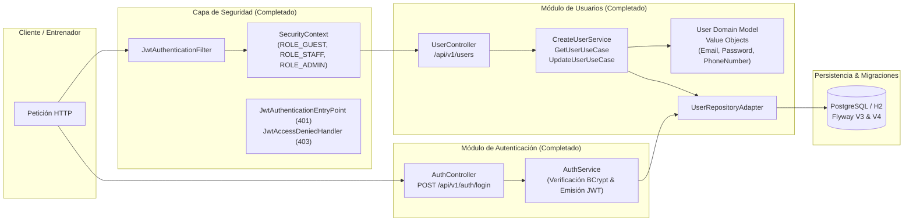
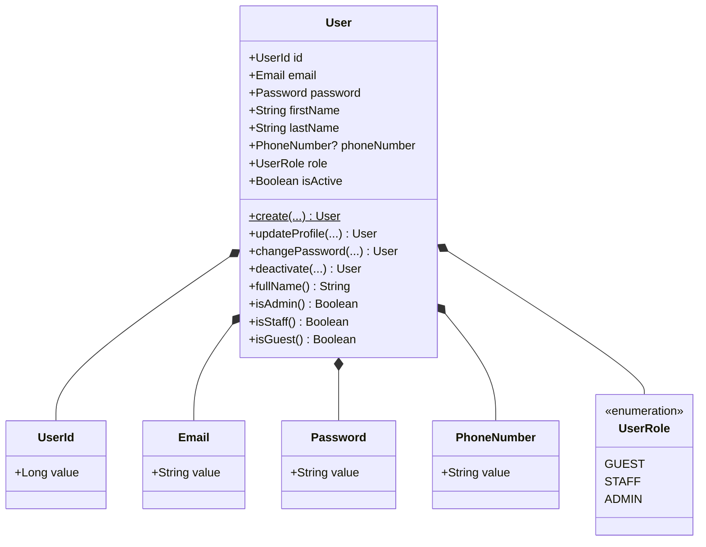
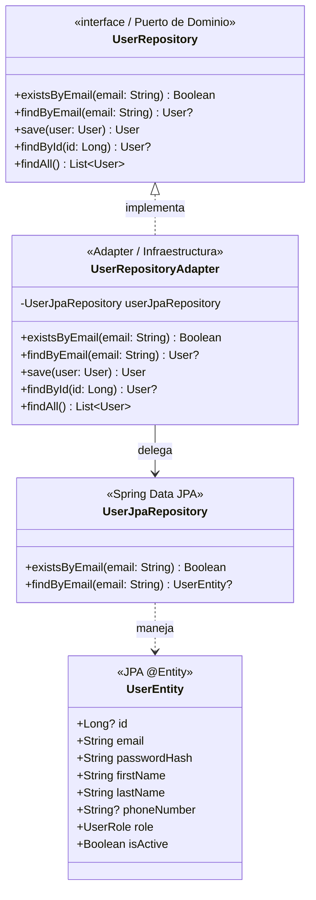
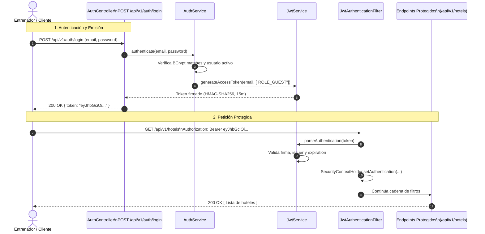
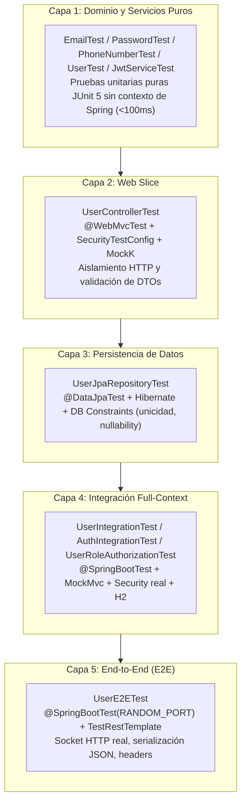

# Semana 5: La Fortaleza de la Seguridad — Users, Security & JWT

> **Estado del Hito:** Completado (Milestone 05: `feature/milestone-05-security`)  
> **Narrativa:** *Capítulo 5: La Fortaleza de Ciudad Azafrán — El Castillo de los Roles y el Guardián JWT*  
> **Objetivo:** Establecer la infraestructura de identidad, gestión de usuarios, cifrado criptográfico y el diseño para autenticación sin estado (Stateless JWT) con autorización basada en roles (`GUEST`, `STAFF`, `ADMIN`) y migraciones Flyway V3 y V4.

---

## 📋 Tabla de Contenidos

1. [Visión General del Hito](#1-visión-general-del-hito)
2. [Estado de Avance: Realidad del Código vs. Hoja de Ruta](#2-estado-de-avance-realidad-del-código-vs-hoja-de-ruta)
3. [Arquitectura de Usuarios y Seguridad (`features/users`, `features/auth`, `config/security`)](#3-arquitectura-de-usuarios-y-seguridad-featuresusers-featuresauth-configsecurity)
4. [Diseño de Dominio: Value Objects e Invariantes](#4-diseño-de-dominio-value-objects-e-invariantes)
5. [Criptografía y Hashing con BCrypt](#5-criptografía-y-hashing-con-bcrypt)
6. [Persistencia y Desacoplamiento (Ports & Adapters)](#6-persistencia-y-desacoplamiento-ports--adapters)
7. [Controlador REST y Casos de Uso (CRUD)](#7-controlador-rest-y-casos-de-uso-crud)
8. [Evolución de Base de Datos con Flyway: V3 y V4](#8-evolución-de-base-de-datos-con-flyway-v3-y-v4)
9. [Spring Security con JWT Stateless (Implementación Integrada)](#9-spring-security-con-jwt-stateless-implementación-integrada)
10. [Roles y Autoridades Granulares: GUEST, STAFF y ADMIN (BC-008)](#10-roles-y-autoridades-granulares-guest-staff-y-admin-bc-008)
11. [Estrategia de Pruebas en 5 Capas, TDD y Fixtures de Seguridad (BC-009 & BC-010)](#11-estrategia-de-pruebas-en-5-capas-tdd-y-fixtures-de-seguridad-bc-009--bc-010)
12. [Guía Práctica: Verificación y Pruebas HTTP](#12-guía-práctica-verificación-y-pruebas-http)
13. [Conclusión y Próximos Pasos](#13-conclusión-y-próximos-pasos)

---

## 1. Visión General del Hito

En el **Gran Hotel Pokémon**, la llegada masiva de entrenadores, líderes de gimnasio y personal administrativo exige levantar una defensa inexpugnable. No podemos permitir que intrusos del *Team Rocket* accedan a reservas ajenas, falsifiquen identidades o lean datos sensibles.

Este hito consolida la seguridad integral desde la identidad de los usuarios hasta la protección criptográfica en cada petición HTTP:



> [!NOTE]
> La implementación sigue rigurosamente los principios de **Screaming Architecture**, **Clean Core**, **Inversión de Dependencias (DIP)** y **TDD (Test-Driven Development)**, garantizando que el dominio permanezca completamente aislado de los frameworks web y de persistencia.

---

## 2. Estado de Avance: Realidad del Código vs. Hoja de Ruta

El hito de seguridad se divide en las fases principales registradas en nuestro [BACKLOG.md](../../../BACKLOG.md) y especificadas mediante [OpenSpec](../../../openspec/):

| Código | Ítem / Funcionalidad | Estado | Rama / Entregable |
| :--- | :--- | :---: | :--- |
| **BC-006** | **CRUD de Users con Value Objects & BCrypt** | `DONE` (Completado) | Código funcional en `features/users/`, Flyway V3, pruebas unitarias, `@WebMvcTest` y `@DataJpaTest`. |
| **BC-007** | **Stateless JWT Authentication** | `DONE` (Completado) | Filtros JWT, emisión y firma JJWT 0.12.6, `AuthController`, manejo de 401/403 con `ErrorResponse`, y suite `AuthIntegrationTest`. |
| **BC-008** | **Roles y Autoridades Granulares (GUEST, STAFF, ADMIN)** | `DONE` (Completado) | Enum [`UserAuthority`](file:///home/algforge/work/springboot-course/src/main/kotlin/com/lgzarturo/springbootcourse/features/users/UserAuthority.kt), [`UserRole`](file:///home/algforge/work/springboot-course/src/main/kotlin/com/lgzarturo/springbootcourse/features/users/UserRole.kt) con mapeo de permisos, migración Flyway V4 (`V4__Add_Roles_Authorities.sql`) y suite `UserRoleAuthorizationTest`. |
| **BC-009** | **Estrategia de Pruebas en Capas (Layered Feature Testing)** | `DONE` (Completado) | Arquitectura de 5 capas (Unitaria, Web Slice, Data JPA, Integración MockMvc y E2E), helper [`LayeredTestSupport`](file:///home/algforge/work/springboot-course/src/test/kotlin/com/lgzarturo/springbootcourse/support/LayeredTestSupport.kt), [`UserIntegrationTest`](file:///home/algforge/work/springboot-course/src/test/kotlin/com/lgzarturo/springbootcourse/features/users/UserIntegrationTest.kt), [`UserE2ETest`](file:///home/algforge/work/springboot-course/src/test/kotlin/com/lgzarturo/springbootcourse/features/users/UserE2ETest.kt) y convención BDD. |
| **BC-010** | **Verificación Exhaustiva de Endpoints Protegidos & Test Fixtures** | `DONE` (Completado) | Matriz de autorización [`ProtectedEndpointAuthorizationTest`](file:///home/algforge/work/springboot-course/src/test/kotlin/com/lgzarturo/springbootcourse/config/security/ProtectedEndpointAuthorizationTest.kt), soporte [`SecurityTestConfig`](file:///home/algforge/work/springboot-course/src/test/kotlin/com/lgzarturo/springbootcourse/support/SecurityTestConfig.kt), y fixtures semánticos `@WithMockDomainUser` y `@WithMockUser`. |

---

## 3. Arquitectura de Usuarios, Seguridad y Pruebas (`features/users`, `features/auth`, `config/security`, `support/`)

La solución organiza los conceptos de identidad, seguridad y pruebas estratificadas siguiendo **Screaming Architecture**, desacoplando el dominio de la infraestructura criptográfica, de los filtros de red y de los entornos de prueba:

```
src/main/kotlin/com/lgzarturo/springbootcourse/
├── config/security/
│   ├── JwtProperties.kt              # Propiedades tipadas (secret, expiration, issuer)
│   ├── JwtService.kt                 # Generación, parseo y validación de tokens JJWT
│   ├── JwtAuthenticationFilter.kt    # OncePerRequestFilter para cabecera Bearer
│   ├── SecurityConfig.kt             # SecurityFilterChain, reglas HTTP y autorización
│   └── SecurityExceptionHandlers.kt  # EntryPoint (401) y AccessDeniedHandler (403)
├── features/auth/
│   ├── AuthController.kt             # Endpoint POST /api/v1/auth/login
│   ├── AuthService.kt                # Verificación de credenciales y emisión de token
│   ├── dto/
│   │   ├── LoginRequest.kt           # DTO de login con Bean Validation
│   │   └── LoginResponse.kt          # DTO con token JWT
│   └── exceptions/
│       └── InvalidCredentialsException.kt # 401 Unauthorized vía GlobalExceptionHandler
└── features/users/
    ├── User.kt                       # Entidad pura de Dominio
    ├── UserRole.kt                   # Enum de roles con mapeo de autoridades (GUEST, STAFF, ADMIN)
    ├── UserAuthority.kt              # Enum de autoridades granulares (users:*, hotels:*, reservations:*)
    ├── CreateUserCommand.kt          # Comando de entrada inmutable
    ├── UpdateUserCommand.kt          # Comando de actualización inmutable
    ├── CreateUserService.kt          # Caso de uso: Alta con hash BCrypt y unicidad
    ├── GetUserUseCase.kt             # Caso de uso: Consulta por ID y listado
    ├── UpdateUserUseCase.kt          # Caso de uso: Actualización y desactivación
    ├── PasswordEncoder.kt            # Componente de hashing y verificación (encode y matches)
    ├── UserRepository.kt             # Puerto de Dominio (existsByEmail, findByEmail, save, findById, findAll)
    ├── UserRepositoryAdapter.kt      # Adaptador de persistencia
    ├── UserJpaRepository.kt          # Repositorio Spring Data JPA
    ├── UserEntity.kt                 # Entidad JPA para tabla 'users'
    ├── UserController.kt             # Adaptador de entrada REST (/api/v1/users)
    ├── UserMapper.kt                 # Mapeo a UserResponse (sin exponer password)
    ├── dto/
    │   ├── CreateUserRequest.kt      # DTO de entrada con validaciones Jakarta
    │   ├── UpdateUserRequest.kt      # DTO de actualización parcial
    │   └── UserResponse.kt           # DTO de respuesta seguro
    ├── exceptions/
    │   └── DuplicateEmailException.kt# Excepción de dominio para 409 Conflict
    └── valueobjects/
        ├── Email.kt                  # Value Object con validación de regex
        ├── Password.kt               # Value Object con validación de fortaleza y hash
        ├── PhoneNumber.kt            # Value Object con formato internacional E.164
        └── UserId.kt                 # Identificador fuertemente tipado

src/test/kotlin/com/lgzarturo/springbootcourse/
├── support/
│   ├── LayeredTestSupport.kt                 # Utilidades compartidas: fixtures únicos y acuñación de tokens JWT (BC-009)
│   ├── SecurityTestConfig.kt                 # Configuración mock de seguridad y @WithMockDomainUser (BC-010)
│   └── SecurityTestConfigIsolationTest.kt    # Pruebas de aislamiento de slices con SecurityTestConfig (BC-010)
├── config/security/
│   └── ProtectedEndpointAuthorizationTest.kt # 4. Matriz de verificación de endpoints protegidos (BC-010)
├── security/
│   ├── JwtServiceTest.kt                     # 1. Pruebas unitarias de tokens y criptografía
│   ├── JwtTestHelper.kt                      # Utilidad de soporte para firmas y expiración de tokens
│   ├── WithMockUser.kt                       # Anotación @WithMockUser y factory con roles/autoridades (BC-010)
│   └── SecurityTestConfig.kt                 # Typealias de compatibilidad hacia support.SecurityTestConfig
└── features/users/
    ├── valueobjects/                         # 1. Pruebas unitarias de Value Objects (Email, Password, Phone)
    ├── UserTest.kt                           # 1. Pruebas unitarias del Aggregate Root
    ├── CreateUserServiceTest.kt              # 1. Pruebas unitarias de casos de uso con MockK
    ├── UserControllerTest.kt                 # 2. Pruebas Web Slice con @WebMvcTest
    ├── UserJpaRepositoryTest.kt              # 3. Pruebas de Persistencia con @DataJpaTest
    ├── UserIntegrationTest.kt                # 4. Pruebas de Integración con @SpringBootTest y MockMvc (BC-009)
    ├── UserRoleAuthorizationTest.kt          # 4. Pruebas de Autorización y roles granulares (BC-008)
    └── UserE2ETest.kt                        # 5. Pruebas End-to-End con TestRestTemplate y puerto real (BC-009)
```

---

## 4. Diseño de Dominio: Value Objects e Invariantes

Uno de los mayores defectos en arquitecturas anémicas es la **obsesión por los tipos primitivos** (*Primitive Obsession*), donde cadenas de texto (`String`) se usan indistintamente para correos, contraseñas y teléfonos, dispersando las validaciones.

En nuestro diseño, aprovechamos las **clases de valor en línea de Kotlin** (`@JvmInline value class`). Esto aporta seguridad estricta de tipos en tiempo de compilación sin la penalización de rendimiento en memoria de instanciar objetos en el Heap:



### 4.1. [Email.kt](file:///home/algforge/work/springboot-course/src/main/kotlin/com/lgzarturo/springbootcourse/features/users/valueobjects/Email.kt)

Garantiza invariantes RFC de formato de correo en su inicializador:

```kotlin
@JvmInline
value class Email(val value: String) {
    init {
        require(isValid(value)) { "Invalid email format: $value" }
    }

    companion object {
        private val EMAIL_REGEX = "^[A-Za-z0-9+_.-]+@[A-Za-z0-9.-]+\\.[A-Za-z]{2,}$".toRegex()
        fun isValid(email: String): Boolean = EMAIL_REGEX.matches(email)
    }
}
```

### 4.2. [Password.kt](file:///home/algforge/work/springboot-course/src/main/kotlin/com/lgzarturo/springbootcourse/features/users/valueobjects/Password.kt)

La contraseña admite dos estados válidos de forma transparente:
1. **Contraseña cruda segura:** Mínimo 8 caracteres, al menos una mayúscula, una minúscula y un dígito numérico.
2. **Hash encriptado:** Formato estándar BCrypt (`$2a$`, `$2b$`, `$2y$`).

```kotlin
@JvmInline
value class Password(val value: String) {
    init {
        require(isSecure(value) || isEncrypted(value)) {
            "Password must be at least 8 characters and contain uppercase, lowercase, and number"
        }
    }

    companion object {
        private val PASSWORD_REGEX = "^(?=.*[a-z])(?=.*[A-Z])(?=.*\\d).{8,}$".toRegex()

        fun isSecure(password: String): Boolean = PASSWORD_REGEX.matches(password)
        fun fromEncrypted(encrypted: String): Password = Password(encrypted)
        private fun isEncrypted(password: String): Boolean = 
            password.matches("^\\$2[aby]\\$\\d{2}\\$.{53}$".toRegex())
    }
}
```

> [!TIP]
> Al permitir tanto contraseñas seguras como hashes validados mediante `fromEncrypted`, el Value Object previene que contraseñas débiles entren al sistema y al mismo tiempo permite reconstituir la entidad desde la base de datos sin romper invariantes.

### 4.3. [PhoneNumber.kt](file:///home/algforge/work/springboot-course/src/main/kotlin/com/lgzarturo/springbootcourse/features/users/valueobjects/PhoneNumber.kt)

Asegura el estándar telefónico internacional **E.164** (ejemplo: `+5219981234567` o `+14155552671`):

```kotlin
@JvmInline
value class PhoneNumber(val value: String) {
    init {
        require(isValid(value)) { "Invalid phone number format: $value" }
    }

    companion object {
        private val PHONE_REGEX = "^\\+?[1-9]\\d{1,14}$".toRegex()
        fun isValid(phone: String): Boolean = PHONE_REGEX.matches(phone)
    }
}
```

### 4.4. La Entidad Pura de Dominio: [User.kt](file:///home/algforge/work/springboot-course/src/main/kotlin/com/lgzarturo/springbootcourse/features/users/User.kt)

La entidad de dominio es inmutable. Toda modificación genera una nueva instancia con `.copy()`, garantizando thread-safety y trazabilidad:

```kotlin
data class User(
    val id: UserId,
    val email: Email,
    val password: Password,
    val firstName: String,
    val lastName: String,
    val phoneNumber: PhoneNumber?,
    val role: UserRole,
    val isActive: Boolean,
) {
    companion object {
        fun create(
            email: Email,
            password: Password,
            firstName: String,
            lastName: String,
            phoneNumber: PhoneNumber?,
            role: UserRole = UserRole.GUEST,
        ): User {
            require(firstName.isNotBlank()) { "First name cannot be blank" }
            require(lastName.isNotBlank()) { "Last name cannot be blank" }

            return User(
                id = UserId.generate(),
                email = email,
                password = password,
                firstName = firstName,
                lastName = lastName,
                phoneNumber = phoneNumber,
                role = role,
                isActive = true,
            )
        }
    }

    fun updateProfile(firstName: String?, lastName: String?, phoneNumber: PhoneNumber?): User =
        copy(
            firstName = firstName ?: this.firstName,
            lastName = lastName ?: this.lastName,
            phoneNumber = phoneNumber ?: this.phoneNumber,
        )

    fun changePassword(newPassword: Password): User = copy(password = newPassword)
    fun deactivate(): User = copy(isActive = false)
    fun fullName(): String = "$firstName $lastName"
    fun isAdmin(): Boolean = role == UserRole.ADMIN
    fun isStaff(): Boolean = role == UserRole.STAFF
    fun isGuest(): Boolean = role == UserRole.GUEST
}
```

---

## 5. Criptografía y Hashing con BCrypt

Las contraseñas **NUNCA** deben persistirse en texto plano ni usando algoritmos rotos o rápidos como MD5 o SHA-1. Los atacantes pueden realizar miles de millones de intentos por segundo mediante tablas arcoíris (*rainbow tables*).

### 5.1. ¿Por qué BCrypt?
- **Salado automático (*salt*):** Genera una sal criptográfica aleatoria de 16 bytes que se incluye en el hash resultante. Dos usuarios con la misma contraseña generan hashes completamente distintos.
- **Factor de costo (*work factor*):** Implementa un costo computacional adaptable (por defecto logarítmico `10`, es decir $2^{10} = 1024$ iteraciones de hashing) para ralentizar intencionalmente ataques de fuerza bruta.

### 5.2. Dependencia Mínima en Gradle
Para no acoplar el proyecto al starter completo de seguridad antes de tiempo, agregamos la dependencia quirúrgica en [build.gradle.kts](file:///home/algforge/work/springboot-course/build.gradle.kts#L98):

```kotlin
implementation("org.springframework.security:spring-security-crypto")
```

### 5.3. El Componente [PasswordEncoder.kt](file:///home/algforge/work/springboot-course/src/main/kotlin/com/lgzarturo/springbootcourse/features/users/PasswordEncoder.kt)

```kotlin
@Component
class PasswordEncoder {
    private val delegate = BCryptPasswordEncoder()

    fun encode(rawPassword: CharSequence): String = 
        requireNotNull(delegate.encode(rawPassword))

    fun matches(
        rawPassword: CharSequence,
        encodedPassword: String,
    ): Boolean = delegate.matches(rawPassword, encodedPassword)
}
```

En el servicio de registro [CreateUserService.kt](file:///home/algforge/work/springboot-course/src/main/kotlin/com/lgzarturo/springbootcourse/features/users/CreateUserService.kt) se utiliza `encode` al dar de alta al usuario:

```kotlin
val user = User.create(
    email = Email(command.email),
    password = Password.fromEncrypted(passwordEncoder.encode(command.password)),
    firstName = command.firstName,
    lastName = command.lastName,
    phoneNumber = command.phoneNumber?.let(::PhoneNumber),
    role = command.role,
)
```

Y en el servicio de autenticación [AuthService.kt](file:///home/algforge/work/springboot-course/src/main/kotlin/com/lgzarturo/springbootcourse/features/auth/AuthService.kt) se invoca `matches` para contrastar de forma segura la contraseña en texto claro contra el hash almacenado:

```kotlin
if (!user.isActive || !passwordEncoder.matches(password, user.password.value)) {
    throw InvalidCredentialsException()
}
```

### 5.4. Protección Contra Fugas: [UserMapper.kt](file:///home/algforge/work/springboot-course/src/main/kotlin/com/lgzarturo/springbootcourse/features/users/UserMapper.kt)

El DTO [UserResponse.kt](file:///home/algforge/work/springboot-course/src/main/kotlin/com/lgzarturo/springbootcourse/features/users/dto/UserResponse.kt) deliberadamente omite la contraseña y su hash. El mapper garantiza que ninguna petición REST reciba el secreto:

```kotlin
@Component
class UserMapper {
    fun toResponse(user: User): UserResponse =
        UserResponse(
            id = user.id.value,
            email = user.email.value,
            firstName = user.firstName,
            lastName = user.lastName,
            phoneNumber = user.phoneNumber?.value,
            role = user.role.name,
        )
}
```

---

## 6. Persistencia y Desacoplamiento (Ports & Adapters)

El dominio no conoce a Hibernate ni a JPA. Esta separación se logra mediante el patrón de **Puertos y Adaptadores**:



1. **Puerto:** [`UserRepository`](file:///home/algforge/work/springboot-course/src/main/kotlin/com/lgzarturo/springbootcourse/features/users/UserRepository.kt) define operaciones sobre objetos `User` puros (incluyendo `findByEmail` para autenticación).
2. **Entidad de Base de Datos:** [`UserEntity`](file:///home/algforge/work/springboot-course/src/main/kotlin/com/lgzarturo/springbootcourse/features/users/UserEntity.kt) contiene las anotaciones JPA (`@Table(name = "users")`, `@Column(name = "password_hash")`).
3. **Adaptador:** [`UserRepositoryAdapter`](file:///home/algforge/work/springboot-course/src/main/kotlin/com/lgzarturo/springbootcourse/features/users/UserRepositoryAdapter.kt) traduce bidireccionalmente entre `User` y `UserEntity`.

---

## 7. Controlador REST y Casos de Uso (CRUD)

El controlador [`UserController`](file:///home/algforge/work/springboot-course/src/main/kotlin/com/lgzarturo/springbootcourse/features/users/UserController.kt) expone las operaciones estándar bajo `/api/v1/users`:

| Método | Endpoint | Descripción | Código Éxito | Códigos Error |
| :--- | :--- | :--- | :---: | :---: |
| `POST` | `/api/v1/users` | Registrar nuevo usuario (Rol GUEST) | `201 Created` | `400 Bad Request`, `409 Conflict` |
| `GET` | `/api/v1/users/{id}` | Consultar usuario por identificador | `200 OK` | `404 Not Found` |
| `GET` | `/api/v1/users` | Listar todos los usuarios activos | `200 OK` | — |
| `PUT` | `/api/v1/users/{id}` | Actualizar datos de perfil (nombre, teléfono) | `200 OK` | `400 Bad Request`, `404 Not Found` |
| `DELETE`| `/api/v1/users/{id}` | Desactivación lógica (*Soft delete*) | `204 No Content` | `404 Not Found` |

### Casos de Uso Transaccionales
- **[`CreateUserService`](file:///home/algforge/work/springboot-course/src/main/kotlin/com/lgzarturo/springbootcourse/features/users/CreateUserService.kt):** Verifica si el correo ya existe; si existe, lanza `DuplicateEmailException` (mapeada a `409 Conflict`). Si no existe, encripta la contraseña y persiste.
- **[`GetUserUseCase`](file:///home/algforge/work/springboot-course/src/main/kotlin/com/lgzarturo/springbootcourse/features/users/GetUserUseCase.kt):** Con `@Transactional(readOnly = true)` para optimizar consultas de solo lectura. Lanza `NoSuchElementException` cuando no existe el ID (mapeado a `404 Not Found`).
- **[`UpdateUserUseCase`](file:///home/algforge/work/springboot-course/src/main/kotlin/com/lgzarturo/springbootcourse/features/users/UpdateUserUseCase.kt):** Actualiza el perfil o ejecuta `deactivate()`, respetando invariantes de negocio.

---

## 8. Evolución de Base de Datos con Flyway: V3 y V4

La persistencia evoluciona de forma declarativa e incremental a través de scripts SQL versionados con Flyway.

### 8.1. Migración Implementada: [V3__Add_Users_Table.sql](file:///home/algforge/work/springboot-course/src/main/resources/db/migration/V3__Add_Users_Table.sql)

Crea la tabla `users` para soportar la persistencia del agregado de usuario:

```sql
create table users (
    id bigint generated by default as identity primary key,
    email varchar(255) not null unique,
    password_hash varchar(60) not null,
    first_name varchar(100) not null,
    last_name varchar(100) not null,
    phone_number varchar(16),
    role varchar(20) not null,
    is_active boolean not null
);
```

**Puntos clave:**
- `password_hash varchar(60)`: Tamaño exacto requerido por los hashes estándar de BCrypt (60 caracteres ASCII).
- `email unique`: Restricción única a nivel motor para evitar colisiones de concurrencia.
- `role varchar(20)`: Almacena el enum del rol actual (`GUEST`, `STAFF`, `ADMIN`).

---

### 8.2. Migración Implementada: [V4__Add_Roles_Authorities.sql](file:///home/algforge/work/springboot-course/src/main/resources/db/migration/V4__Add_Roles_Authorities.sql) (BC-008)

Para soportar el modelo granular de permisos y relaciones Many-to-Many entre usuarios, roles y autoridades, se integró la evolución declarativa del esquema con semillas idempotentes y migración de datos históricos:

```sql
create table if not exists roles (
    id bigint generated by default as identity primary key,
    name varchar(50) not null unique
);

create table if not exists authorities (
    id bigint generated by default as identity primary key,
    name varchar(50) not null unique
);

create table if not exists roles_authorities (
    role_id bigint not null references roles(id) on delete cascade,
    authority_id bigint not null references authorities(id) on delete cascade,
    primary key (role_id, authority_id)
);

create table if not exists users_roles (
    user_id bigint not null references users(id) on delete cascade,
    role_id bigint not null references roles(id) on delete cascade,
    primary key (user_id, role_id)
);

-- Idempotent seeds for roles
insert into roles (name)
select 'ROLE_GUEST' where not exists (select 1 from roles where name = 'ROLE_GUEST');
insert into roles (name)
select 'ROLE_STAFF' where not exists (select 1 from roles where name = 'ROLE_STAFF');
insert into roles (name)
select 'ROLE_ADMIN' where not exists (select 1 from roles where name = 'ROLE_ADMIN');

-- Idempotent seeds for authorities
insert into authorities (name)
select 'users:read' where not exists (select 1 from authorities where name = 'users:read');
insert into authorities (name)
select 'users:write' where not exists (select 1 from authorities where name = 'users:write');
insert into authorities (name)
select 'hotels:read' where not exists (select 1 from authorities where name = 'hotels:read');
insert into authorities (name)
select 'hotels:manage' where not exists (select 1 from authorities where name = 'hotels:manage');
insert into authorities (name)
select 'reservations:create_own' where not exists (select 1 from authorities where name = 'reservations:create_own');
insert into authorities (name)
select 'reservations:manage' where not exists (select 1 from authorities where name = 'reservations:manage');

-- Idempotent mapping: ROLE_GUEST (lectura de hoteles y reservas personales)
insert into roles_authorities (role_id, authority_id)
select r.id, a.id
from roles r cross join authorities a
where r.name = 'ROLE_GUEST'
  and a.name in ('hotels:read', 'reservations:create_own')
  and not exists (
      select 1 from roles_authorities ra where ra.role_id = r.id and ra.authority_id = a.id
  );

-- Idempotent mapping: ROLE_STAFF (gestión de catálogo de hoteles y reservas)
insert into roles_authorities (role_id, authority_id)
select r.id, a.id
from roles r cross join authorities a
where r.name = 'ROLE_STAFF'
  and a.name in ('hotels:read', 'hotels:manage', 'reservations:manage')
  and not exists (
      select 1 from roles_authorities ra where ra.role_id = r.id and ra.authority_id = a.id
  );

-- Idempotent mapping: ROLE_ADMIN (acceso integral)
insert into roles_authorities (role_id, authority_id)
select r.id, a.id
from roles r cross join authorities a
where r.name = 'ROLE_ADMIN'
  and a.name in ('users:read', 'users:write', 'hotels:read', 'hotels:manage', 'reservations:manage')
  and not exists (
      select 1 from roles_authorities ra where ra.role_id = r.id and ra.authority_id = a.id
  );

-- Migración segura de usuarios preexistentes de V3 hacia users_roles
insert into users_roles (user_id, role_id)
select u.id, r.id
from users u
join roles r on r.name = ('ROLE_' || u.role)
where not exists (
    select 1 from users_roles ur where ur.user_id = u.id and ur.role_id = r.id
);
```

---

## 9. Spring Security con JWT Stateless (Implementación Integrada)

En arquitecturas orientadas a microservicios y APIs REST, el almacenamiento de sesiones en memoria del servidor (`JSESSIONID`) genera problemas de escalabilidad horizontal y requiere infraestructura compleja como sesiones pegajosas (*Sticky Sessions*) o clusters de Redis.

La solución estándar es la **autenticación sin estado (Stateless JWT)**, la cual ha sido integrada en su totalidad bajo el ítem **BC-007**:



### 9.1. Dependencias Incorporadas en Gradle

Se añadieron en [build.gradle.kts](file:///home/algforge/work/springboot-course/build.gradle.kts#L97-L103) las librerías oficiales de Spring Security y la suite JJWT 0.12.6:

```kotlin
implementation("org.springframework.boot:spring-boot-starter-security")
implementation("org.springframework.security:spring-security-crypto")
// JWT (BC-007)
implementation("io.jsonwebtoken:jjwt-api:0.12.6")
runtimeOnly("io.jsonwebtoken:jjwt-impl:0.12.6")
runtimeOnly("io.jsonwebtoken:jjwt-jackson:0.12.6")

testImplementation("org.springframework.security:spring-security-test")
```

### 9.2. Propiedades de Configuración Tipadas y Fail-Fast: [JwtProperties.kt](file:///home/algforge/work/springboot-course/src/main/kotlin/com/lgzarturo/springbootcourse/config/security/JwtProperties.kt)

Las propiedades se gestionan de forma type-safe mediante `@ConfigurationProperties`. Se valida de forma estricta (*fail-fast*) que el secreto cumpla con el estándar criptográfico HMAC-SHA256 (mínimo 256 bits / 32 bytes):

```kotlin
@ConfigurationProperties(prefix = "jwt")
data class JwtProperties(
    val secret: String,
    val accessTokenExpiration: Duration,
    val issuer: String,
) {
    init {
        require(secret.toByteArray().size >= MIN_SECRET_BYTES) { "jwt.secret must be at least 256 bits" }
    }

    companion object {
        const val MIN_SECRET_BYTES = 32
    }
}
```

En [application.yaml](file:///home/algforge/work/springboot-course/src/main/resources/application.yaml):

```yaml
jwt:
  secret: ${JWT_SECRET}
  access-token-expiration: 15m
  issuer: springboot-course
```

> [!WARNING]
> La clave secreta nunca se incluye en el repositorio. Debe inyectarse mediante la variable de entorno `JWT_SECRET` (ver [.env.example](file:///home/algforge/work/springboot-course/.env.example)). Para entornos de prueba locales se puede generar con:  
> `python3 -c "import secrets; print(secrets.token_urlsafe(48))"`

### 9.3. Generación y Validación de Tokens con JJWT 0.12.x: [JwtService.kt](file:///home/algforge/work/springboot-course/src/main/kotlin/com/lgzarturo/springbootcourse/config/security/JwtService.kt)

Encapsula la firma y el parseo defensivo de tokens. Los claims incorporan el sujeto (`sub`), emisor (`iss`), fecha de emisión (`iat`), expiración (`exp`) y roles con prefijo de autoridad (`ROLE_`):

```kotlin
@Service
class JwtService(
    private val properties: JwtProperties,
) {
    private val signingKey: SecretKey by lazy { Keys.hmacShaKeyFor(properties.secret.toByteArray()) }

    fun generateAccessToken(
        email: String,
        roles: List<String>,
    ): String = generateToken(email, roles, properties.accessTokenExpiration)

    fun generateToken(
        email: String,
        roles: List<String>,
        timeToLive: Duration,
    ): String {
        val now = Date()
        return Jwts.builder()
            .subject(email)
            .issuer(properties.issuer)
            .issuedAt(now)
            .expiration(Date(now.time + timeToLive.toMillis()))
            .claim(ROLES_CLAIM, roles)
            .signWith(signingKey)
            .compact()
    }

    fun parseAuthentication(token: String): Authentication? =
        try {
            val claims = Jwts.parser()
                .verifyWith(signingKey)
                .requireIssuer(properties.issuer)
                .build()
                .parseSignedClaims(token)
                .payload
            val authorities = claims.get(ROLES_CLAIM, List::class.java)
                .map { SimpleGrantedAuthority(it.toString()) }
            UsernamePasswordAuthenticationToken(claims.subject, null, authorities)
        } catch (ex: JwtException) {
            null
        } catch (ex: IllegalArgumentException) {
            null
        }

    companion object {
        const val ROLES_CLAIM = "roles"
    }
}
```

### 9.4. Filtro por Petición: [JwtAuthenticationFilter.kt](file:///home/algforge/work/springboot-course/src/main/kotlin/com/lgzarturo/springbootcourse/config/security/JwtAuthenticationFilter.kt)

Hereda de `OncePerRequestFilter`. Extrae el token del encabezado HTTP `Authorization: Bearer <token>`, delega su resolución a `JwtService` y puebla el contexto de Spring Security sin realizar consultas redundantes a la base de datos:

```kotlin
@Component
class JwtAuthenticationFilter(
    private val jwtService: JwtService,
) : OncePerRequestFilter() {
    override fun doFilterInternal(
        request: HttpServletRequest,
        response: HttpServletResponse,
        filterChain: FilterChain,
    ) {
        val header = request.getHeader(HttpHeaders.AUTHORIZATION)
        if (header != null && header.startsWith(BEARER_PREFIX)) {
            val authentication = jwtService.parseAuthentication(header.substring(BEARER_PREFIX.length))
            if (authentication != null && SecurityContextHolder.getContext().authentication == null) {
                SecurityContextHolder.getContext().authentication = authentication
            }
        }
        filterChain.doFilter(request, response)
    }

    companion object {
        private const val BEARER_PREFIX = "Bearer "
    }
}
```

### 9.5. Manejo Homogéneo de Errores de Seguridad: [SecurityExceptionHandlers.kt](file:///home/algforge/work/springboot-course/src/main/kotlin/com/lgzarturo/springbootcourse/config/security/SecurityExceptionHandlers.kt)

En APIs REST, los fallos de autenticación o autorización no deben retornar páginas HTML. Se devuelven respuestas JSON homogéneas serializando el DTO [`ErrorResponse`](file:///home/algforge/work/springboot-course/src/main/kotlin/com/lgzarturo/springbootcourse/common/exception/ErrorResponse.kt) con Jackson:

- **`JwtAuthenticationEntryPoint`:** Retorna HTTP `401 Unauthorized` cuando el cliente no aporta un token o este no es válido.
- **`JwtAccessDeniedHandler`:** Retorna HTTP `403 Forbidden` cuando el cliente carece del rol necesario.
- **`GlobalExceptionHandler`:** Captura [`InvalidCredentialsException`](file:///home/algforge/work/springboot-course/src/main/kotlin/com/lgzarturo/springbootcourse/features/auth/exceptions/InvalidCredentialsException.kt) ante contraseñas incorrectas o cuentas inactivas, retornando HTTP `401 Unauthorized`.

### 9.6. Cadena de Filtros de Seguridad: [SecurityConfig.kt](file:///home/algforge/work/springboot-course/src/main/kotlin/com/lgzarturo/springbootcourse/config/security/SecurityConfig.kt)

Configura el `SecurityFilterChain` aplicando la política de mínimos privilegios:

```kotlin
@Configuration
@EnableWebSecurity
@EnableMethodSecurity
@EnableConfigurationProperties(JwtProperties::class)
class SecurityConfig(
    private val jwtAuthenticationFilter: JwtAuthenticationFilter,
    private val authenticationEntryPoint: AuthenticationEntryPoint,
    private val accessDeniedHandler: AccessDeniedHandler,
) {
    @Bean
    fun securityFilterChain(http: HttpSecurity): SecurityFilterChain {
        http
            .csrf { it.disable() }
            .sessionManagement { it.sessionCreationPolicy(SessionCreationPolicy.STATELESS) }
            .authorizeHttpRequests { auth ->
                auth.requestMatchers(HttpMethod.POST, "/api/v1/auth/login").permitAll()
                auth.requestMatchers(HttpMethod.POST, "/api/v1/users").permitAll()
                auth.requestMatchers(*PUBLIC_PATHS).permitAll()
                auth.requestMatchers(HttpMethod.GET, "/api/v1/hotels/**").authenticated()
                auth.requestMatchers(HttpMethod.GET, "/api/v1/users/*").authenticated()
                auth.requestMatchers("/api/v1/hotels/**").hasAnyRole("STAFF", "ADMIN")
                auth.requestMatchers(HttpMethod.GET, "/api/v1/users").hasAnyRole("STAFF", "ADMIN")
                auth.requestMatchers(HttpMethod.PUT, "/api/v1/users/**").hasAnyRole("STAFF", "ADMIN")
                auth.requestMatchers(HttpMethod.DELETE, "/api/v1/users/**").hasAnyRole("STAFF", "ADMIN")
                auth.anyRequest().authenticated()
            }.exceptionHandling { ex ->
                ex.authenticationEntryPoint(authenticationEntryPoint)
                ex.accessDeniedHandler(accessDeniedHandler)
            }.addFilterBefore(jwtAuthenticationFilter, UsernamePasswordAuthenticationFilter::class.java)
        return http.build()
    }

    companion object {
        private val PUBLIC_PATHS = arrayOf(
            "/actuator/health",
            "/actuator/info",
            "/api-docs/**",
            "/swagger-ui/**",
            "/swagger-ui.html",
            "/error",
        )
    }
}
```

### 9.7. Servicio y Controlador de Autenticación (`features/auth`)

El caso de uso de login autentica contra el puerto [`UserRepository`](file:///home/algforge/work/springboot-course/src/main/kotlin/com/lgzarturo/springbootcourse/features/users/UserRepository.kt) y verifica la contraseña con `PasswordEncoder.matches`.

**[`AuthService.kt`](file:///home/algforge/work/springboot-course/src/main/kotlin/com/lgzarturo/springbootcourse/features/auth/AuthService.kt):**

```kotlin
@Service
class AuthService(
    private val userRepository: UserRepository,
    private val passwordEncoder: PasswordEncoder,
    private val jwtService: JwtService,
) {
    fun authenticate(email: String, password: String): String {
        val user = userRepository.findByEmail(email) ?: throw InvalidCredentialsException()
        if (!user.isActive || !passwordEncoder.matches(password, user.password.value)) {
            throw InvalidCredentialsException()
        }
        return jwtService.generateAccessToken(user.email.value, user.role.allGrantedAuthorities())
    }
}
```

**[`AuthController.kt`](file:///home/algforge/work/springboot-course/src/main/kotlin/com/lgzarturo/springbootcourse/features/auth/AuthController.kt):**

```kotlin
@RestController
@RequestMapping("/api/v1/auth")
class AuthController(
    private val authService: AuthService,
) {
    @PostMapping("/login")
    fun login(@Valid @RequestBody request: LoginRequest): ResponseEntity<LoginResponse> {
        val token = authService.authenticate(request.email, request.password)
        return ResponseEntity.ok(LoginResponse(token))
    }
}
```

---

## 10. Roles y Autoridades Granulares: GUEST, STAFF y ADMIN (BC-008)

El modelo de autorización separa los roles funcionales de alto nivel de las acciones o permisos específicos en el dominio, permitiendo evaluar reglas de acceso tanto por rol (`hasRole(...)`) como por autoridad atómica (`hasAuthority(...)`).

### 10.1. Modelado de Autoridades y Roles en el Dominio

En [`UserAuthority.kt`](file:///home/algforge/work/springboot-course/src/main/kotlin/com/lgzarturo/springbootcourse/features/users/UserAuthority.kt), cada constante define una capacidad u operación de negocio atómica:

```kotlin
package com.lgzarturo.springbootcourse.features.users

/**
 * Granular authorities for domain operations.
 */
enum class UserAuthority(val value: String) {
    USERS_READ("users:read"),
    USERS_WRITE("users:write"),
    HOTELS_READ("hotels:read"),
    HOTELS_MANAGE("hotels:manage"),
    RESERVATIONS_CREATE_OWN("reservations:create_own"),
    RESERVATIONS_MANAGE("reservations:manage"),
}
```

En [`UserRole.kt`](file:///home/algforge/work/springboot-course/src/main/kotlin/com/lgzarturo/springbootcourse/features/users/UserRole.kt), cada rol vincula un conjunto cerrado de autoridades y expone la función `allGrantedAuthorities()` para proyectarse directamente en el contexto de Spring Security y en los claims del token JWT:

```kotlin
package com.lgzarturo.springbootcourse.features.users

enum class UserRole(
    val authorities: Set<String>,
) {
    GUEST(
        setOf(
            UserAuthority.HOTELS_READ.value,
            UserAuthority.RESERVATIONS_CREATE_OWN.value,
        ),
    ), // Cliente que hace reservas
    STAFF(
        setOf(
            UserAuthority.HOTELS_READ.value,
            UserAuthority.HOTELS_MANAGE.value,
            UserAuthority.RESERVATIONS_MANAGE.value,
        ),
    ), // Personal del hotel
    ADMIN(
        setOf(
            UserAuthority.USERS_READ.value,
            UserAuthority.USERS_WRITE.value,
            UserAuthority.HOTELS_READ.value,
            UserAuthority.HOTELS_MANAGE.value,
            UserAuthority.RESERVATIONS_MANAGE.value,
        ),
    ), // Administrador con acceso completo
    ;

    fun allGrantedAuthorities(): List<String> = listOf("ROLE_$name") + authorities
}
```

Al iniciar sesión en [`AuthService.kt`](file:///home/algforge/work/springboot-course/src/main/kotlin/com/lgzarturo/springbootcourse/features/auth/AuthService.kt), el claim `roles` del token emitido incluye tanto el rol prefijado como sus autoridades granulares:

```json
{
  "sub": "trainer@pokemon.com",
  "roles": [
    "ROLE_GUEST",
    "hotels:read",
    "reservations:create_own"
  ],
  "iss": "springboot-course",
  "exp": 1729000000
}
```

### 10.2. Matriz de Autorizaciones y Reglas HTTP Integradas

| Recurso / Operación | Método & Ruta | Anónimo | GUEST | STAFF | ADMIN | Autoridad Requerida / Regla |
| :--- | :--- | :---: | :---: | :---: | :---: | :--- |
| **Login / Obtener Token** | `POST /api/v1/auth/login` | ✅ | ✅ | ✅ | ✅ | `permitAll()` |
| **Registro de Huésped** | `POST /api/v1/users` | ✅ | ✅ | ✅ | ✅ | `permitAll()` (Asigna rol `GUEST`) |
| **Consultar Perfil por ID** | `GET /api/v1/users/{id}` | ❌ (401) | ✅ | ✅ | ✅ | `authenticated()` |
| **Listar Todos los Usuarios** | `GET /api/v1/users` | ❌ (401) | ❌ (403) | ✅ | ✅ | `hasAnyRole('STAFF', 'ADMIN')` o `users:read` |
| **Actualizar Usuario** | `PUT /api/v1/users/{id}` | ❌ (401) | ❌ (403) | ✅ | ✅ | `hasAnyRole('STAFF', 'ADMIN')` o `users:write` |
| **Desactivar Usuario** | `DELETE /api/v1/users/{id}`| ❌ (401) | ❌ (403) | ❌ (403) | ✅ | `hasRole('ADMIN')` |
| **Consultar Catálogo Hoteles**| `GET /api/v1/hotels/**` | ❌ (401) | ✅ | ✅ | ✅ | `authenticated()` o `hotels:read` |
| **Crear / Editar Hotel** | `POST/PUT /api/v1/hotels/**`| ❌ (401) | ❌ (403) | ✅ | ✅ | `hasAnyRole('STAFF', 'ADMIN')` o `hotels:manage` |

### 10.3. Meta-Anotaciones Limpias en Kotlin

En lugar de dispersar cadenas mágicas SpEL (`@PreAuthorize("hasRole('ADMIN')")`), Kotlin permite definir meta-anotaciones reutilizables:

```kotlin
@Target(AnnotationTarget.FUNCTION, AnnotationTarget.CLASS)
@Retention(AnnotationRetention.RUNTIME)
@PreAuthorize("hasRole('ADMIN')")
annotation class RequireAdmin

@Target(AnnotationTarget.FUNCTION, AnnotationTarget.CLASS)
@Retention(AnnotationRetention.RUNTIME)
@PreAuthorize("hasAnyRole('STAFF', 'ADMIN')")
annotation class RequireStaffOrAdmin
```

### 10.4. Verificación Automatizada: [`UserRoleAuthorizationTest.kt`](file:///home/algforge/work/springboot-course/src/test/kotlin/com/lgzarturo/springbootcourse/features/users/UserRoleAuthorizationTest.kt)

La suite de pruebas valida la proyección de claims y las restricciones de seguridad:

```kotlin
@SpringBootTest
@AutoConfigureMockMvc
@AutoConfigureTestDatabase(replace = AutoConfigureTestDatabase.Replace.ANY)
@ActiveProfiles("test")
@DisplayName("User Role and Authority Authorization Tests")
class UserRoleAuthorizationTest {
    @Autowired private lateinit var mockMvc: MockMvc
    @Autowired private lateinit var authService: AuthService
    @Autowired private lateinit var createUserService: CreateUserService
    @Value("\${jwt.secret:TestSecretKeyForJwtSigningThatIsLongEnough1234567890}")
    private lateinit var jwtSecret: String

    @Test
    @DisplayName("FR-001 & FR-002: Login token must contain roles and granular authorities")
    fun `login token contains roles and granular authorities`() {
        val email = "trainer.auth@pokemon.com"
        createUserService.execute(
            CreateUserCommand(
                email = email,
                password = "Password123!",
                firstName = "Red",
                lastName = "Trainer",
                phoneNumber = null,
                role = UserRole.GUEST,
            ),
        )

        val token = authService.authenticate(email, "Password123!")
        val claims = JwtTestHelper.parseClaims(token, jwtSecret)

        @Suppress("UNCHECKED_CAST")
        val roles = claims.get("roles", List::class.java) as List<String>
        assertTrue(roles.contains("ROLE_GUEST"))
        assertTrue(roles.contains("hotels:read"))
        assertTrue(roles.contains("reservations:create_own"))
    }

    @Test
    @DisplayName("FR-003: GUEST can read hotels but cannot create or modify them")
    fun `guest can read hotels but cannot create them`() {
        val guestToken = JwtTestHelper.mintToken(
            jwtSecret, "guest@pokemon.com",
            listOf("ROLE_GUEST", "hotels:read", "reservations:create_own"),
        )

        mockMvc.perform(
            get("/api/v1/hotels").header("Authorization", "Bearer $guestToken")
        ).andExpect(status().isOk)

        mockMvc.perform(
            post("/api/v1/hotels")
                .header("Authorization", "Bearer $guestToken")
                .contentType(MediaType.APPLICATION_JSON)
                .content("""{"name":"Guest Created Hotel","address":"Cerulean City"}""")
        ).andExpect(status().isForbidden)
    }
}
```

---

## 11. Estrategia de Pruebas en 5 Capas, TDD y Fixtures de Seguridad (BC-009 & BC-010)

Para garantizar la estabilidad del sistema sin degradar los tiempos de retroalimentación en CI/CD, el módulo de usuarios y seguridad adopta una **estrategia de pruebas en 5 capas** con separación estricta de responsabilidades:



### 11.1. Capa 1: Pruebas Unitarias de Dominio y Criptografía

Pruebas puras sin iniciar `ApplicationContext` de Spring. Ejecutan en milisegundos y prueban invariantes del modelo:

- [`EmailTest.kt`](file:///home/algforge/work/springboot-course/src/test/kotlin/com/lgzarturo/springbootcourse/features/users/valueobjects/EmailTest.kt): Valida rechazo de correos sin `@`, sin dominio o con caracteres inválidos.
- [`PasswordTest.kt`](file:///home/algforge/work/springboot-course/src/test/kotlin/com/lgzarturo/springbootcourse/features/users/valueobjects/PasswordTest.kt): Valida longitud mínima (>= 8), presencia de mayúsculas y dígitos, y aceptación de hashes BCrypt (`$2a$10$...`).
- [`PhoneNumberTest.kt`](file:///home/algforge/work/springboot-course/src/test/kotlin/com/lgzarturo/springbootcourse/features/users/valueobjects/PhoneNumberTest.kt): Valida formato numérico y rechazo de cadenas alfanuméricas.
- [`UserTest.kt`](file:///home/algforge/work/springboot-course/src/test/kotlin/com/lgzarturo/springbootcourse/features/users/UserTest.kt): Valida creación del agregado `User`, cálculo de `fullName`, cambio de contraseña y desactivación.
- [`JwtServiceTest.kt`](file:///home/algforge/work/springboot-course/src/test/kotlin/com/lgzarturo/springbootcourse/security/JwtServiceTest.kt): Valida firma HMAC-SHA256, expiración con duraciones negativas, y rechazo de tokens con clave simétrica alterada.
- [`CreateUserServiceTest.kt`](file:///home/algforge/work/springboot-course/src/test/kotlin/com/lgzarturo/springbootcourse/features/users/CreateUserServiceTest.kt): Valida orquestación con MockK, asegurando que correos duplicados lanzan `DuplicateEmailException` sin persistir.

### 11.2. Capa 2: Pruebas de Web Slice (`@WebMvcTest`)

En [`UserControllerTest.kt`](file:///home/algforge/work/springboot-course/src/test/kotlin/com/lgzarturo/springbootcourse/features/users/UserControllerTest.kt), Spring levanta únicamente la capa de controladores y validación de beans:

- `@Import(SecurityTestConfig::class)` aísla la seguridad HTTP para concentrarse en la serialización, mapeo y validaciones `@Valid`.
- Las dependencias de casos de uso se simulan con MockK (`every { createUserService.execute(...) } returns ...`), sin acceder a bases de datos.
- Valida que las respuestas HTTP nunca expongan el campo `password` ni detalles del hash interno.

### 11.3. Capa 3: Persistencia de Datos (`@DataJpaTest`)

En [`UserJpaRepositoryTest.kt`](file:///home/algforge/work/springboot-course/src/test/kotlin/com/lgzarturo/springbootcourse/features/users/UserJpaRepositoryTest.kt), se prueba el repositorio real contra una base de datos configurando JPA y Hibernate:

```kotlin
@DataJpaTest
class UserJpaRepositoryTest(
    @Autowired private val userJpaRepository: UserJpaRepository,
) {
    @Test
    @DisplayName("debe_persistir_y_encontrar_usuario_por_correo_cuando_datos_son_validos")
    fun `should persist and find a user by email`() {
        userJpaRepository.save(userEntity())

        assertTrue(userJpaRepository.existsByEmail("ash@pokemon.com"))
    }

    @Test
    @DisplayName("debe_rechazar_insercion_cuando_correo_es_duplicado")
    fun `should reject duplicate emails`() {
        userJpaRepository.saveAndFlush(userEntity())

        assertThrows<DataIntegrityViolationException> {
            userJpaRepository.saveAndFlush(userEntity())
        }
    }
}
```

### 11.4. Capa 4: Pruebas de Integración Full-Context (`@SpringBootTest` + `MockMvc`)

En [`UserIntegrationTest.kt`](file:///home/algforge/work/springboot-course/src/test/kotlin/com/lgzarturo/springbootcourse/features/users/UserIntegrationTest.kt), se carga el contexto de Spring completo, incluyendo la cadena de filtros de seguridad, los repositorios reales y los casos de uso:

```kotlin
@SpringBootTest
@AutoConfigureMockMvc
@AutoConfigureTestDatabase(replace = AutoConfigureTestDatabase.Replace.ANY)
@ActiveProfiles("test")
@DisplayName("User Layered Integration Tests")
class UserIntegrationTest {
    @Autowired private lateinit var mockMvc: MockMvc
    @Autowired private lateinit var objectMapper: ObjectMapper
    @Autowired private lateinit var userRepository: UserRepository
    @Value("\${jwt.secret:TestSecretKeyForJwtSigningThatIsLongEnough1234567890}")
    private lateinit var jwtSecret: String

    @Test
    @DisplayName("debe_registrar_usuario_cuando_datos_son_validos")
    fun `debe_registrar_usuario_cuando_datos_son_validos`() {
        val email = LayeredTestSupport.uniqueEmail("ash.register")
        val request = CreateUserRequest(
            email = email,
            password = "Password123!",
            firstName = "Ash",
            lastName = "Ketchum",
            phoneNumber = "+14155552671",
        )

        mockMvc.perform(
            post("/api/v1/users")
                .contentType(MediaType.APPLICATION_JSON)
                .content(objectMapper.writeValueAsString(request)),
        ).andExpect(status().isCreated)
            .andExpect(jsonPath("$.id").isNumber)
            .andExpect(jsonPath("$.email").value(email))
            .andExpect(jsonPath("$.role").value("GUEST"))
            .andExpect(jsonPath("$.password").doesNotExist())
    }

    @Test
    @DisplayName("debe_retornar_conflicto_cuando_correo_ya_existe")
    fun `debe_retornar_conflicto_cuando_correo_ya_existe`() {
        val email = LayeredTestSupport.uniqueEmail("duplicate")
        val request = CreateUserRequest(
            email = email,
            password = "Password123!",
            firstName = "Brock",
            lastName = "Boulder",
            phoneNumber = null,
        )

        mockMvc.perform(
            post("/api/v1/users")
                .contentType(MediaType.APPLICATION_JSON)
                .content(objectMapper.writeValueAsString(request)),
        ).andExpect(status().isCreated)

        mockMvc.perform(
            post("/api/v1/users")
                .contentType(MediaType.APPLICATION_JSON)
                .content(objectMapper.writeValueAsString(request)),
        ).andExpect(status().isConflict)
    }

    @Test
    @DisplayName("debe_obtener_usuario_por_id_cuando_solicitante_esta_autenticado")
    fun `debe_obtener_usuario_por_id_cuando_solicitante_esta_autenticado`() {
        val email = LayeredTestSupport.uniqueEmail("misty.profile")
        val user = userRepository.save(
            User.create(
                email = Email(email),
                password = Password("Password123!"),
                firstName = "Misty",
                lastName = "Waterflower",
                phoneNumber = null,
                role = UserRole.GUEST,
            ),
        )

        val token = LayeredTestSupport.mintTokenForRole(jwtSecret, email, UserRole.GUEST)

        mockMvc.perform(
            get("/api/v1/users/${user.id.value}")
                .header("Authorization", "Bearer $token"),
        ).andExpect(status().isOk)
            .andExpect(jsonPath("$.id").value(user.id.value))
            .andExpect(jsonPath("$.email").value(email))
            .andExpect(jsonPath("$.firstName").value("Misty"))
    }

    @Test
    @DisplayName("debe_actualizar_perfil_cuando_datos_son_validos_y_usuario_es_admin")
    fun `debe_actualizar_perfil_cuando_datos_son_validos_y_usuario_es_admin`() {
        val email = LayeredTestSupport.uniqueEmail("update.target")
        val user = userRepository.save(
            User.create(
                email = Email(email),
                password = Password("Password123!"),
                firstName = "Gary",
                lastName = "Oak",
                phoneNumber = null,
                role = UserRole.GUEST,
            ),
        )

        val adminEmail = LayeredTestSupport.uniqueEmail("admin.actor")
        val adminToken = LayeredTestSupport.mintTokenForRole(jwtSecret, adminEmail, UserRole.ADMIN)

        val updateRequest = UpdateUserRequest(
            firstName = "Blue",
            lastName = "Oak",
            phoneNumber = "+14155559999",
        )

        mockMvc.perform(
            put("/api/v1/users/${user.id.value}")
                .header("Authorization", "Bearer $adminToken")
                .contentType(MediaType.APPLICATION_JSON)
                .content(objectMapper.writeValueAsString(updateRequest)),
        ).andExpect(status().isOk)
            .andExpect(jsonPath("$.firstName").value("Blue"))
            .andExpect(jsonPath("$.phoneNumber").value("+14155559999"))
    }

    @Test
    @DisplayName("debe_retornar_no_encontrado_cuando_id_no_existe")
    fun `debe_retornar_no_encontrado_cuando_id_no_existe`() {
        val adminEmail = LayeredTestSupport.uniqueEmail("admin.check")
        val adminToken = LayeredTestSupport.mintTokenForRole(jwtSecret, adminEmail, UserRole.ADMIN)

        mockMvc.perform(
            get("/api/v1/users/999999")
                .header("Authorization", "Bearer $adminToken"),
        ).andExpect(status().isNotFound)
    }
}
```

Junto a [`UserIntegrationTest.kt`](file:///home/algforge/work/springboot-course/src/test/kotlin/com/lgzarturo/springbootcourse/features/users/UserIntegrationTest.kt), esta capa incluye [`AuthIntegrationTest.kt`](file:///home/algforge/work/springboot-course/src/test/kotlin/com/lgzarturo/springbootcourse/features/auth/AuthIntegrationTest.kt) (10 tests de autenticación y filtros) y [`UserRoleAuthorizationTest.kt`](file:///home/algforge/work/springboot-course/src/test/kotlin/com/lgzarturo/springbootcourse/features/users/UserRoleAuthorizationTest.kt) (4 tests de roles y autoridades).

### 11.5. Capa 5: Pruebas End-to-End (E2E) con Socket Real

En [`UserE2ETest.kt`](file:///home/algforge/work/springboot-course/src/test/kotlin/com/lgzarturo/springbootcourse/features/users/UserE2ETest.kt), la aplicación se ejecuta sobre un servidor HTTP embebido en un puerto aleatorio no privilegiado (`webEnvironment = RANDOM_PORT`):

- Emplea `TestRestTemplate` para enviar peticiones HTTP reales a través del socket de red local.
- Valida la deserialización de cabeceras, códigos HTTP estándar (`HttpStatus.CREATED`, `HttpStatus.OK`, `HttpStatus.CONFLICT`) y el flujo completo de vida:
  1. Registro de usuario mediante `POST /api/v1/users`.
  2. Autenticación contra `POST /api/v1/auth/login` extrayendo el token JWT emitido.
  3. Consulta de perfil autenticada mediante cabecera `Authorization: Bearer <token>`.
  4. Rechazo con código `409 Conflict` cuando se intenta registrar un correo ya ocupado.

```kotlin
@SpringBootTest(webEnvironment = SpringBootTest.WebEnvironment.RANDOM_PORT)
@AutoConfigureTestDatabase(replace = AutoConfigureTestDatabase.Replace.ANY)
@ActiveProfiles("test")
@DisplayName("User E2E Tests")
class UserE2ETest {
    @LocalServerPort private var port: Int = 0
    @Value("\${jwt.secret:TestSecretKeyForJwtSigningThatIsLongEnough1234567890}")
    private lateinit var jwtSecret: String
    private val restTemplate = TestRestTemplate()

    private fun baseUrl(path: String): String = "http://localhost:$port$path"

    @Test
    @DisplayName("debe_registrar_y_autenticar_usuario_en_flujo_e2e")
    fun `debe_registrar_y_autenticar_usuario_en_flujo_e2e`() {
        val email = LayeredTestSupport.uniqueEmail("e2e.register")
        val registerRequest = CreateUserRequest(
            email = email,
            password = "Password123!",
            firstName = "Red",
            lastName = "Champion",
            phoneNumber = "+14155551111",
        )

        val registerHeaders = HttpHeaders().apply { contentType = MediaType.APPLICATION_JSON }
        val registerEntity = HttpEntity(registerRequest, registerHeaders)

        val registerResponse = restTemplate.postForEntity(
            baseUrl("/api/v1/users"),
            registerEntity,
            UserResponse::class.java,
        )

        assertEquals(HttpStatus.CREATED, registerResponse.statusCode)
        assertNotNull(registerResponse.body)
        assertEquals(email, registerResponse.body?.email)

        // Login E2E
        val loginBody = mapOf("email" to email, "password" to "Password123!")
        val loginResponse = restTemplate.postForEntity(
            baseUrl("/api/v1/auth/login"),
            HttpEntity(loginBody, registerHeaders),
            Map::class.java,
        )

        assertEquals(HttpStatus.OK, loginResponse.statusCode)
        assertNotNull(loginResponse.body?.get("token"))
    }

    @Test
    @DisplayName("debe_consultar_perfil_con_token_jwt_en_flujo_e2e")
    fun `debe_consultar_perfil_con_token_jwt_en_flujo_e2e`() {
        val email = LayeredTestSupport.uniqueEmail("e2e.profile")
        val registerRequest = CreateUserRequest(
            email = email,
            password = "Password123!",
            firstName = "Blue",
            lastName = "Rival",
            phoneNumber = null,
        )

        val headers = HttpHeaders().apply { contentType = MediaType.APPLICATION_JSON }
        val created = restTemplate.postForEntity(
            baseUrl("/api/v1/users"),
            HttpEntity(registerRequest, headers),
            UserResponse::class.java,
        )

        assertEquals(HttpStatus.CREATED, created.statusCode)
        val userId = requireNotNull(created.body?.id)

        val token = LayeredTestSupport.mintTokenForRole(jwtSecret, email, UserRole.GUEST)
        val authHeaders = HttpHeaders().apply { setBearerAuth(token) }

        val profileResponse = restTemplate.exchange(
            baseUrl("/api/v1/users/$userId"),
            HttpMethod.GET,
            HttpEntity<Void>(authHeaders),
            UserResponse::class.java,
        )

        assertEquals(HttpStatus.OK, profileResponse.statusCode)
        assertEquals("Blue", profileResponse.body?.firstName)
    }

    @Test
    @DisplayName("debe_rechazar_registro_con_correo_duplicado_en_flujo_e2e")
    fun `debe_rechazar_registro_con_correo_duplicado_en_flujo_e2e`() {
        val email = LayeredTestSupport.uniqueEmail("e2e.dup")
        val registerRequest = CreateUserRequest(
            email = email,
            password = "Password123!",
            firstName = "Oak",
            lastName = "Professor",
        )

        val headers = HttpHeaders().apply { contentType = MediaType.APPLICATION_JSON }
        val first = restTemplate.postForEntity(
            baseUrl("/api/v1/users"),
            HttpEntity(registerRequest, headers),
            UserResponse::class.java,
        )
        assertEquals(HttpStatus.CREATED, first.statusCode)

        val second = restTemplate.postForEntity(
            baseUrl("/api/v1/users"),
            HttpEntity(registerRequest, headers),
            String::class.java,
        )
        assertEquals(HttpStatus.CONFLICT, second.statusCode)
    }
}
```

### 11.6. Soporte Compartido de Pruebas: [`LayeredTestSupport.kt`](file:///home/algforge/work/springboot-course/src/test/kotlin/com/lgzarturo/springbootcourse/support/LayeredTestSupport.kt)

Para evitar duplicación y garantizar aislamiento de datos entre pruebas concurrentes, el módulo introduce un singleton de utilidades para testing:

```kotlin
package com.lgzarturo.springbootcourse.support

import com.lgzarturo.springbootcourse.features.users.UserRole
import com.lgzarturo.springbootcourse.security.JwtTestHelper

/**
 * Shared helpers and fixtures for layered feature testing (BC-009).
 */
object LayeredTestSupport {
    fun uniqueEmail(prefix: String = "trainer"): String =
        "$prefix.${System.nanoTime()}@pokemon.com"

    fun uniquePhone(): String =
        "+1415${(1000000..9999999).random()}"

    fun mintTokenForRole(
        secret: String,
        email: String,
        role: UserRole,
        issuer: String = "springboot-course-test",
    ): String =
        JwtTestHelper.mintToken(
            secret = secret,
            subject = email,
            roles = role.allGrantedAuthorities(),
            issuer = issuer,
            ttlMillis = 3600_000,
        )
}
```

- **`uniqueEmail(prefix)`**: Previene colisiones por restricción de clave única (`UNIQUE`) utilizando `System.nanoTime()`.
- **`uniquePhone()`**: Genera números compatibles con el formato E.164.
- **`mintTokenForRole(...)`**: Emite tokens JWT sintéticos válidos para cualquier rol sin necesidad de ejecutar un HTTP login en cada caso de prueba, acelerando la suite de integración.

### 11.7. Convención de Nombres BDD: `@DisplayName("debe_resultado_cuando_condicion")`

Todas las pruebas en capas de nivel de integración, persistencia y E2E implementan la convención BDD en español:

- Formato: `@DisplayName("debe_<resultado_esperado>_cuando_<condicion_o_estimulo>")`
- Ejemplo: `@DisplayName("debe_retornar_conflicto_cuando_correo_ya_existe")`
- Esta convención genera reportes de ejecución claros tanto en consola como en reportes HTML de Gradle (`build/reports/tests/test/index.html`), permitiendo identificar instantáneamente la regla de negocio que falla.

### 11.8. Verificación Matricial de Endpoints Protegidos y Fixtures Reutilizables (BC-010)

Para asegurar que ninguna refactorización degrade las restricciones de acceso y proporcionar herramientas ergonómicas de testing para futuros desarrollos, el ítem **BC-010** establece una batería de pruebas de integración matricial y un conjunto de utilidades y fixtures reutilizables.

#### 11.8.1. Matriz de Autorización en [`ProtectedEndpointAuthorizationTest.kt`](file:///home/algforge/work/springboot-course/src/test/kotlin/com/lgzarturo/springbootcourse/config/security/ProtectedEndpointAuthorizationTest.kt)

Esta suite levanta el contexto completo de Spring Security y valida sistemáticamente los 4 estados de acceso sobre todas las rutas protegidas:

1. **Peticiones Anónimas (401 Unauthorized):**
   Cualquier petición sin cabecera `Authorization` hacia rutas protegidas (`GET /api/v1/hotels`, `POST /api/v1/hotels`, `GET /api/v1/users`) es interceptada por `JwtAuthenticationEntryPoint`:
   ```kotlin
   @Test
   @DisplayName("debe_retornar_401_cuando_solicitud_no_tiene_autenticacion")
   fun `debe_retornar_401_cuando_solicitud_no_tiene_autenticacion`() {
       mockMvc.perform(get("/api/v1/hotels")).andExpect(status().isUnauthorized)
       mockMvc.perform(
           post("/api/v1/hotels")
               .contentType(MediaType.APPLICATION_JSON)
               .content("""{"name":"Unauthorized Hotel","address":"Route 1"}""")
       ).andExpect(status().isUnauthorized)
       mockMvc.perform(get("/api/v1/users")).andExpect(status().isUnauthorized)
   }
   ```

2. **Peticiones con Roles Insuficientes (403 Forbidden):**
   Tokens con roles o autoridades no autorizados son rechazados por `JwtAccessDeniedHandler`:
   - `GUEST` intentando crear un hotel (`POST /api/v1/hotels`) -> `403 Forbidden`.
   - `GUEST` intentando listar usuarios (`GET /api/v1/users`) -> `403 Forbidden`.
   - `STAFF` intentando listar usuarios (`GET /api/v1/users`) -> `403 Forbidden`.

3. **Peticiones Autorizadas por Rol y Autoridad (200 OK / 201 Created):**
   - `GUEST` con autoridad `hotels:read` -> `GET /api/v1/hotels` retorna `200 OK`.
   - `STAFF` con autoridad `hotels:manage` -> `POST /api/v1/hotels` retorna `201 Created`.
   - `ADMIN` con rol `ROLE_ADMIN` y autoridad `users:read` -> `GET /api/v1/users` retorna `200 OK`.

4. **Resiliencia Criptográfica y Rechazo de Tokens Inválidos (401 Unauthorized):**
   - Tokens expirados (`ttlMillis = -10_000`) retornan `401 Unauthorized`.
   - Tokens firmados con una clave simétrica no coincidente retornan `401 Unauthorized`.
   - Cadenas arbitrarias o malformadas (`invalid.malformed.token`) retornan `401 Unauthorized`.

#### 11.8.2. Fixtures Semánticos de Seguridad: `@WithMockDomainUser` y `@WithMockUser`

Para evitar la construcción manual y repetitiva de tokens JWT en cada prueba de controlador o integración, el proyecto introduce anotaciones personalizadas que inyectan el `SecurityContext`:

- **[`@WithMockDomainUser`](file:///home/algforge/work/springboot-course/src/test/kotlin/com/lgzarturo/springbootcourse/support/SecurityTestConfig.kt#L23-L45):**
  Anotación orientada a dominio que recibe el enum [`UserRole`](file:///home/algforge/work/springboot-course/src/main/kotlin/com/lgzarturo/springbootcourse/features/users/UserRole.kt) (`GUEST`, `STAFF`, `ADMIN`) y delega en `WithMockDomainUserSecurityContextFactory` para poblar el `SecurityContext` con todas las autoridades resultantes de `role.allGrantedAuthorities()`:
  ```kotlin
  @Test
  @WithMockDomainUser(role = UserRole.STAFF)
  @DisplayName("debe_permitir_creacion_hoteles_cuando_se_usa_mock_domain_user_staff")
  fun `debe_permitir_creacion_hoteles_cuando_se_usa_mock_domain_user_staff`() {
      mockMvc.perform(
          post("/api/v1/hotels")
              .contentType(MediaType.APPLICATION_JSON)
              .content("""{"name":"Staff Created Hotel","address":"Cinnabar Island"}""")
      ).andExpect(status().isCreated)
  }
  ```

- **[`@WithMockUser`](file:///home/algforge/work/springboot-course/src/test/kotlin/com/lgzarturo/springbootcourse/security/WithMockUser.kt):**
  Anotación flexible para escenarios donde se requiere personalizar el nombre de usuario y granularidad de permisos explícitos (`roles = ["ADMIN"]`, `authorities = ["users:read"]`).

#### 11.8.3. Aislamiento de Slices Web MVC con [`SecurityTestConfig.kt`](file:///home/algforge/work/springboot-course/src/test/kotlin/com/lgzarturo/springbootcourse/support/SecurityTestConfig.kt)

Las pruebas unitarias de controladores (`@WebMvcTest`) deben ejecutar a la máxima velocidad sin inicializar bases de datos ni la cadena de producción completa.

Para ello, [`SecurityTestConfig.kt`](file:///home/algforge/work/springboot-course/src/test/kotlin/com/lgzarturo/springbootcourse/support/SecurityTestConfig.kt) provee un `@TestConfiguration` que sustituye el servicio criptográfico por un mock relajado:

```kotlin
@TestConfiguration
class SecurityTestConfig {
    // Los slices @WebMvcTest incluyen el filtro JWT real pero no la cadena de
    // seguridad ni JwtService: se sustituye por un mock que deja pasar todo.
    @Bean
    fun jwtService(): JwtService = mockk(relaxed = true)
}
```

La efectividad y el aislamiento estricto de esta configuración se comprueban en [`SecurityTestConfigIsolationTest.kt`](file:///home/algforge/work/springboot-course/src/test/kotlin/com/lgzarturo/springbootcourse/support/SecurityTestConfigIsolationTest.kt), garantizando que ningún bean de seguridad de prueba se filtre fuera del entorno de test ni contamine el componente scan de producción.

---

## 12. Guía Práctica: Verificación y Pruebas HTTP

El proyecto incluye archivos interactivos compatibles con IntelliJ IDEA, VS Code (REST Client) y herramientas CLI:

### 12.1. Autenticación y Endpoints Protegidos: [`http/auth.http`](file:///home/algforge/work/springboot-course/http/auth.http)

Permite ejecutar la secuencia completa de login, extracción del token y consumo de recursos protegidos:

```http
### 1. Registrar usuario huésped (Público)
POST http://localhost:8080/api/v1/users
Content-Type: application/json

{
  "email": "trainer.ash@example.com",
  "password": "PikachuPassword123",
  "firstName": "Ash",
  "lastName": "Ketchum",
  "phoneNumber": "+14155552671"
}

### 2. Iniciar sesión y capturar token JWT (Público)
# @name login
POST http://localhost:8080/api/v1/auth/login
Content-Type: application/json

{
  "email": "trainer.ash@example.com",
  "password": "PikachuPassword123"
}

> 

### 3. Consultar recurso protegido sin token (Retorna 401 Unauthorized)
GET http://localhost:8080/api/v1/hotels

### 4. Consultar recurso protegido con Bearer Token (Retorna 200 OK)
GET http://localhost:8080/api/v1/hotels
Authorization: Bearer {{authToken}}

### 5. Intentar mutación restringida con rol GUEST (Retorna 403 Forbidden)
POST http://localhost:8080/api/v1/hotels
Authorization: Bearer {{authToken}}
Content-Type: application/json

{
  "name": "Cerulean Gym Resort",
  "address": "Cerulean Waterfront"
}
```

### 12.2. Gestión de Usuarios: [`http/users.http`](file:///home/algforge/work/springboot-course/http/users.http)

Permite probar las operaciones CRUD del módulo de usuarios y validaciones de datos duplicados e inválidos.

### 12.3. Ejecución de la Suite de Pruebas por Capas

Comandos Gradle optimizados para verificar cada capa del sistema:

```bash
# 1. Pruebas unitarias de dominio y criptografía (< 1 segundo)
./gradlew test --tests "*EmailTest*" --tests "*PasswordTest*" --tests "*JwtServiceTest*"

# 2. Pruebas de Web Slice de controladores
./gradlew test --tests "*UserControllerTest*"

# 3. Pruebas de persistencia JPA
./gradlew test --tests "*UserJpaRepositoryTest*"

# 4. Pruebas de integración MockMvc (Seguridad, Auth y Roles)
./gradlew test --tests "*UserIntegrationTest*" --tests "*AuthIntegrationTest*" --tests "*UserRoleAuthorizationTest*"

# 5. Pruebas End-to-End con servidor web en puerto dinámico
./gradlew test --tests "*UserE2ETest*"

# 6. Matriz de verificación de endpoints protegidos y fixtures (BC-010)
./gradlew test --tests "*ProtectedEndpointAuthorizationTest*" --tests "*SecurityTestConfigIsolationTest*"

# Suite completa de verificación (todas las capas)
./gradlew test
```

---

## 13. Conclusión y Próximos Pasos

El hito **`feature/milestone-05-security`** cuenta con sus cinco componentes centrales completamente implementados, verificados y cubiertos por la suite de pruebas automatizadas:

- ✅ **BC-006 (CRUD de Usuarios):** Entidad pura `User`, Value Objects (`Email`, `Password`, `PhoneNumber`, `UserId`), cifrado BCrypt con `PasswordEncoder`, arquitectura hexagonal con puertos y adaptadores, y migración Flyway V3.
- ✅ **BC-007 (Stateless JWT Authentication):** Configuración de `SecurityFilterChain`, generación y validación de tokens con JJWT 0.12.6 en `JwtService`, filtro por petición `JwtAuthenticationFilter`, controlador `AuthController`, respuestas homogéneas de error 401/403 con `ErrorResponse`, y suite exhaustiva `AuthIntegrationTest`.
- ✅ **BC-008 (Roles y Autoridades Granulares & Flyway V4):** Modelo enum `UserAuthority`, `UserRole` con autoridades asociadas y método `allGrantedAuthorities()`, migración idempotente `V4__Add_Roles_Authorities.sql` con SQL estándar, y pruebas de autorización en `UserRoleAuthorizationTest`.
- ✅ **BC-009 (Estrategia de Pruebas en 5 Capas):** Pirámide de pruebas completa (Unit, Web Slice, Data JPA, Full-Context Integration MockMvc y E2E TestRestTemplate), soporte compartido en `LayeredTestSupport` (fixtures y emisión de tokens), y convención BDD `@DisplayName("debe_resultado_cuando_condicion")`.
- ✅ **BC-010 (Verificación de Endpoints Protegidos y Fixtures de Seguridad):** Matriz exhaustiva de autorización en `ProtectedEndpointAuthorizationTest`, fixtures semánticos `@WithMockDomainUser` y `@WithMockUser`, y configuración de aislamiento `SecurityTestConfig` para slices `@WebMvcTest`.

### Próximo Paso en el Curso:

- 🚀 **Milestone 06 (`feature/milestone-06-testing`):** Implementación de compuertas de calidad automatizadas (**BC-011**) con KtLint, Detekt, JaCoCo (mínimo 85% de cobertura) y documentación OpenAPI completa (**BC-012**).
